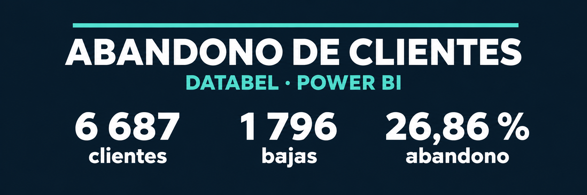
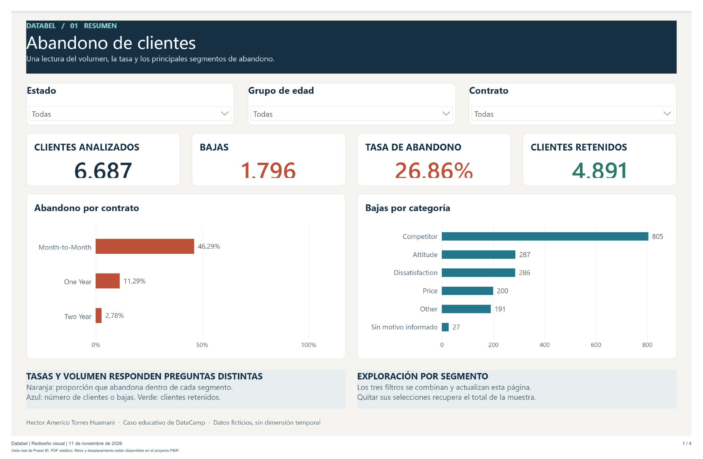

# Databel: diagnóstico del abandono de clientes



**Hector Americo Torres Huamani · Power BI, Power Query y DAX**

Analicé una instantánea de **6 687 clientes** de Databel, una empresa ficticia de telecomunicaciones, para identificar cómo se distribuye el abandono entre contratos, perfiles y planes. Encontré **1 796 bajas**, equivalentes al **26,86 %** de los clientes.

Preparé una adaptación en Power BI con cuatro páginas y nueve medidas DAX, y contrasté los indicadores con Python. El informe organiza el diagnóstico para distinguir tasas, volumen de clientes y motivos declarados.

> Basado en el caso educativo [Case Study: Analyzing Customer Churn in Power BI](https://app.datacamp.com/learn/courses/case-study-analyzing-customer-churn-in-power-bi) de DataCamp. El dataset y el esquema inicial proceden de sus materiales. Las páginas de esta adaptación, las medidas en español, el tratamiento explícito de motivos ausentes y la auditoría independiente están documentados aquí.

## Explorar

- [Descargar el dashboard completo (ZIP)](https://github.com/hectortorres26/databel-churn-power-bi/raw/refs/heads/main/entregables/Databel_dashboard_redisenado.zip): proyecto PBIP, plantilla PBIT, presentación, guía e instrucciones. Versión final del 11 de noviembre de 2026.
- [Proyecto nativo de Power BI (PBIP)](powerbi/DatabelPresentacion/Databel.pbip): descargar el repositorio completo para conservar sus carpetas vinculadas.
- [Presentación del dashboard en PDF](docs/Presentacion_dashboard_Databel.pdf): cuatro vistas reales del informe, listas para exponer.
- [Plantilla de Power BI (alternativa PBIT)](entregables/Databel_abandono.pbit).
- [Notebook de validación independiente](Validacion_Databel.ipynb).
- [Reporte y guía de medidas](docs/Reporte_y_guia_Databel.pdf).
- [Medidas DAX](docs/medidas.dax) y [Power Query](docs/transformaciones.pq).
- [Obtención y procedencia de datos](data/README.md).
- [Resultados calculados](output/metricas.json).

## Resultados principales

| Indicador o segmento | Resultado |
|---|---:|
| Clientes | 6 687 |
| Bajas | 1 796 |
| Tasa global | 26,86 % |
| Contrato mensual | 1 579 / 3 411: 46,29 % |
| Contrato de un año | 167 / 1 479: 11,29 % |
| Contrato de dos años | 50 / 1 797: 2,78 % |
| Bajas asociadas a competencia | 805: 44,82 % de todas las bajas |
| Bajas sin motivo registrado | 27: 1,50 % de todas las bajas |

La distribución de motivos incluye los casos sin información: el denominador es **1 796**, no solo las **1 769** bajas con un motivo conocido. No encontré filas duplicadas ni identificadores de cliente repetidos.

Los usuarios con actividad internacional y sin plan internacional presentan un 40,34 % de abandono; quienes tienen actividad y plan, un 7,59 %. La comparación sugiere investigar la adecuación de los planes, pero no demuestra que contratar uno reduzca el abandono.

## Páginas del informe



1. **Resumen:** clientes, bajas, tasa y clientes retenidos; comparación por contrato y filtros de estado, edad y contrato.
2. **Segmentos:** tasas y volumen por edad, pertenencia a grupos y tabla por estado con clientes, bajas y tasa en la misma fila.
3. **Contratos y planes:** pagos, planes internacionales y de datos, llamadas a soporte ordenadas de 0 a 5, indicadores de contexto y filtro de actividad internacional.
4. **Motivos y calidad:** categorías en barras, detalle de motivos en tabla y controles de integridad.

El reporte conserva todas las categorías: 51 estados y territorios y 21 motivos. La tabla geográfica permite contrastar directamente tasa y tamaño del segmento. Las tasas de los gráficos incorporan clientes y bajas en sus campos de tooltip. Las tablas CSV permiten consultar el detalle completo fuera de Power BI.

El rediseño del 11 de noviembre distingue volumen en azul, abandono en naranja y retención en verde. Incluye una jerarquía tipográfica común, indicadores más visibles, filas alternadas en las tablas y escalas de porcentaje coherentes. Las decisiones y la comparación con la versión anterior están en [Rediseño visual](docs/redisenio_visual.md).

## Cómo abrir y actualizar

Descarga o clona el repositorio y abre `powerbi/DatabelPresentacion/Databel.pbip` en una versión de Power BI Desktop compatible con PBIP/PBIR. Conserva las carpetas `Databel.Report` y `Databel.SemanticModel` junto al archivo. Pulsa **Actualizar** para cargar los datos. El caché local `.pbi/cache.abf` no se publica, por lo que una descarga nueva necesita actualizar el modelo antes de ver los indicadores.

El ZIP de entrega permite descargar solo el dashboard y sus documentos: tras extraer **todo** su contenido, el archivo de entrada es `DatabelPresentacion/Databel.pbip`. Incluye un `LEEME.txt` con los pasos de carga. El modelo nativo se conserva en formato TMDL, verificado contra la definición original.

Como alternativa, abre `entregables/Databel_abandono.pbit`. El parámetro `FuenteCSV` admite la URL propuesta del CSV público original o una ruta absoluta al archivo descargado. La plantilla no incluye datos cargados. Una conexión web pública puede requerir seleccionar acceso anónimo en Power BI. El PDF es una presentación estática; la interacción está en el informe nativo.

Para repetir la auditoría independiente, usa Python 3.11, instala `requirements.txt`, coloca el CSV original como explica [Datos](data/README.md) y ejecuta:

```powershell
python scripts/analizar.py
```

El notebook se ejecuta desde la raíz del repositorio. El análisis exporta únicamente agregaciones; no publica teléfonos ni filas individuales. Power Query elimina el teléfono del modelo y oculta el identificador de cliente del panel de campos.

`powerbi/DatabelPresentacion` es el proyecto **PBIP/PBIR nativo** validado en Desktop. `powerbi/Databel` conserva las definiciones **PbixProj de pbi-tools** usadas para compilar la alternativa PBIT. Ambos reutilizan el mismo modelo. Consulta las [instrucciones de reconstrucción](docs/reconstruccion.md), incluida la procedencia del esquema inicial y la compatibilidad de las herramientas.

## Primera prueba y mejora

La primera exploración permitió calcular la tasa global y comparar contratos. La revisión detectó que los nulos de motivos combinaban clientes retenidos y 27 bajas sin motivo. La adaptación separa «No aplica» de «Sin motivo informado», mantiene el total de bajas y muestra tamaños de segmentos junto con sus tasas.

También distinguí la antigüedad de la cuenta de una fecha de observación. El dataset es una instantánea: no construí una tendencia mensual a partir de la antigüedad ni añadí predicciones que el ejercicio no requiere.

En la revisión añadí el filtro de contrato y los clientes retenidos, aumenté la tipografía y eliminé encabezados duplicados. Incorporé clientes y bajas a los campos de tooltip de las tasas y retiré el límite de 20 categorías. La revisión nativa permitió corregir también el eje de llamadas: ahora muestra cada valor de 0 a 5. Verifiqué las cuatro páginas y el comportamiento de las selecciones guardadas de los segmentadores.

## Validación y estado

- Auditoría con pandas y recuento independiente con la biblioteca estándar: correctos.
- Los totales de los segmentos y motivos se reconcilian con 6 687 clientes y 1 796 bajas.
- Plantilla compilada correctamente; contiene cuatro páginas y nueve medidas.
- Reapertura técnica del archivo PBIT con pbi-tools: recuperados correctamente el modelo, las cuatro páginas, las nueve medidas y el parámetro `FuenteCSV`. Se confirmó la exclusión de `Phone Number`.
- Consultas DAX ejecutadas correctamente en el modelo inicial de DataCamp, mediante su laboratorio de Power BI en Edge: clientes, bajas, tasa, duplicados, motivos vacíos y los tres tipos de contrato coinciden con la auditoría. Consulta la [validación del motor](docs/validacion_edge.md).
- **Modelo propio cargado en Power BI Desktop:** partición lista; nueve medidas y transformación Power Query coincidentes con la definición publicada. Las 13 pruebas de contextos de filtro y las 14 combinaciones de campos y medidas de los gráficos coinciden con el CSV. Incluyen filtros combinados, un contexto vacío y recuperación del total.
- **Plantilla revisada:** compilada y reextraída; modelo idéntico al comprobado, páginas y referencias revisadas técnicamente. Los resultados y el alcance están en [Validación del dashboard](docs/validacion_dashboard.md) y en [la evidencia de consultas](output/validacion_motor.json).
- **Presentación nativa:** cuatro páginas revisadas en Power BI Desktop mediante el CLI oficial de Microsoft; validación PBIR con cero errores y cero advertencias. Las vistas reales están en el PDF de presentación.
- **Segmentadores:** cuatro selecciones guardadas en PBIR, cargadas y renderizadas por Desktop: contrato mensual, mensual y California, 65 o más y actividad internacional. Los valores visibles coinciden con la auditoría. Al eliminar las selecciones se recuperan los totales. Esto comprueba la aplicación del filtro en el informe; no se ensayaron clics de ratón ni hover de tooltips. [Registro nativo](output/validacion_nativa.json).
- DataCamp mostraba los tres capítulos al 100 % **antes** de esta adaptación. No presento ese progreso previo como aprobación de este nuevo archivo por el corrector.

## Conclusiones y límites

Priorizaría la revisión de contratos mensuales y la adecuación de planes internacionales. La competencia es el motivo declarado más frecuente. Estas son hipótesis de trabajo basadas en asociaciones de una muestra ficticia; no se cuantifican efectos causales, ingresos recuperables ni resultados de producción.

Los motivos solo se conocen después del abandono. No deben utilizarse como predictores de una baja futura. Los estados o segmentos pequeños requieren cautela y las comparaciones no ajustan simultáneamente por todas las variables.
